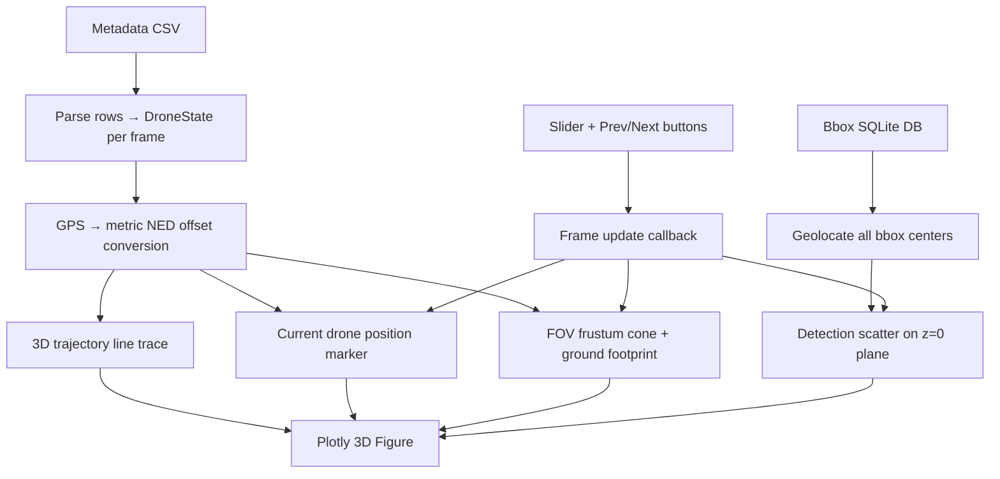

# 3D Post-Flight Metadata Visualizer

A standalone post-flight tool that renders an interactive 3D scene of the entire flight: drone trajectory, current position, camera FOV frustum projected to the ground, and geolocated detection scatter — all built with **Plotly** for smooth WebGL-based interaction.

## Background

The current [manual_target_checker.py](file:///c:/Users/01fge/Documenti/Flight_Team/sft_cv_2025_2026/tools/manual_target_checker.py) produces a 2D matplotlib scatter plot (`_refresh_gps_plot`) showing geolocated bbox centers on a flat East × North metre-offset plane. This new tool adds a full third dimension (altitude) and replaces the static scatter with a rich interactive 3D scene.

### Available Metadata (per CSV row)

From [camera_engine.py](file:///c:/Users/01fge/Documenti/Flight_Team/sft_cv_2025_2026/src/sft_cv/cam/camera_engine.py#L105-L128):

| Field | Source |
|-------|--------|
| `lat`, `lon` | Drone GPS position |
| `alt_msl`, `alt_rel` | Absolute and relative altitude |
| `roll`, `pitch`, `yaw` | Camera attitude (degrees) |
| `filename` | Image path |
| `timestamp` | Acquisition timestamp |

### Camera Parameters (from [sft_config.yaml](file:///c:/Users/01fge/Documenti/Flight_Team/sft_cv_2025_2026/sft_config.yaml))

| Parameter | Value |
|-----------|-------|
| Resolution | **5320 × 3032** px |
| Focal length | **16.0** mm |
| Pixel size | **2.74** µm |
| Sensor size | **14.58 × 8.31** mm |
| HFOV | **48.98°** (confirmed) |
| VFOV | **~29.12°** (derived) |
| `px2body_matrix` | Effective matrix from `decision_system.geoloc.px2body_matrix` composed with `px2body_error_angle_deg` |

---

## Design Decisions

### Plotly (WebGL) as the rendering backend

Plotly provides hardware-accelerated 3D rendering, smooth orbit/pan/zoom, hover tooltips, and a slider widget — all out of the box. It opens in the default browser and requires no additional system dependencies beyond the Python package.

### Standalone tool, separate from the manual checker

The visualizer lives in its own file and is launched independently post-flight. It does **not** modify or depend on the Pygame-based `ManualTargetChecker`. This keeps the two tools decoupled and avoids adding complexity to the existing annotation workflow.

### Image navigation synchronized with 3D state

A **Plotly slider** (frame-based animation) and **Prev / Next buttons** control which image is "current". When the current image changes:
- The drone position marker on the trajectory **grows larger** and changes color to clearly indicate which capture point is selected.
- The FOV frustum cone and ground footprint update to match the selected image's attitude and altitude.
- The detection highlights update to show bboxes belonging to the current image.

---

## Proposed Changes

### [NEW] [flight_3d_visualizer.py](file:///c:/Users/01fge/Documenti/Flight_Team/sft_cv_2025_2026/tools/flight_3d_visualizer.py)

Standalone CLI tool. Launched with:
```bash
pdm run python tools/flight_3d_visualizer.py [-a metadata.csv] [--config sft_config.yaml]
```

---

### Architecture



---

### Data Pipeline

#### 1. Drone State Extraction

For every row in the metadata CSV, extract a `DroneState`:

```python
@dataclass
class DroneState:
    index: int
    filename: str
    lat: float
    lon: float
    alt_rel: float          # metres above ground
    roll: float             # degrees
    pitch: float            # degrees
    yaw: float              # degrees
    timestamp: float | None
    east_m: float = 0.0     # computed: metre offset from centroid
    north_m: float = 0.0    # computed: metre offset from centroid
```

All GPS coordinates are converted to **metre offsets** from the centroid of all drone positions (same approach as the current checker's `_DEG2M_LAT` / `_deg2m_lon` projection).

#### 2. FOV Footprint Computation

For a given `DroneState`, the 4 corners of the image sensor are projected through the camera model to the ground plane at z = 0:

```python
def compute_fov_footprint(state: DroneState, camera: Camera, config: dict) -> np.ndarray:
    """Returns (4, 3) array of ground footprint corners in metric NED."""
    W, H = 5320, 3032
    corners_px = np.array([[0, 0], [W, 0], [W, H], [0, H]], dtype=float)

    # Build Camera.Configuration from drone state
    position = Affine(((0.0, 0.0, -state.alt_rel),), ((), (), ()))
    configuration = camera.Configuration(
        position, state.roll, state.pitch, state.yaw, is_deg=True
    )

    # For each corner pixel, compute the ray in NED space using camera.px2ned()
    # Then intersect each ray with the z = 0 ground plane
    # ray: P(t) = origin + t * direction
    # ground intersection: t = -origin_z / direction_z

    footprint_ned = []
    for cx, cy in corners_px:
        point = Affine(((cx, cy),), ((), ()))
        ned_ray = camera.px2ned(point, configuration)
        origin = ned_ray.vector.flatten()[:3]
        direction = ned_ray.orthCoos2globalCoos_matrix.reshape(3, -1)[:, 0]

        if abs(direction[2]) < 1e-9:
            # Ray parallel to ground — use a far point
            t = 1000.0
        else:
            t = -origin[2] / direction[2]

        ground_point = origin + t * direction
        footprint_ned.append(ground_point)

    return np.array(footprint_ned)  # (4, 3) — north, east, down=0
```

This reuses the **exact same** [Camera.px2ned()](file:///c:/Users/01fge/Documenti/Flight_Team/sft_cv_2025_2026/src/sft_math/cam/cam.py#L269-L279) transform from `sft_math`, guaranteeing physical accuracy including roll, pitch, yaw, and the px2body matrix.

#### 3. Detection Precomputation

Identical to `_precompute_all_bbox_gps()` in the current checker — reads all records from the `bboxes.sqlite3` database, geolocates each bbox center via the camera model, and converts to metric NED. All detections sit on z = 0.

---

### 3D Scene Composition

The Plotly figure is built as a `go.Figure` with multiple traces. **Plotly frames** are used for the slider/animation: each frame updates only the traces that change per-image (current marker, FOV cone, current-image detection highlights).

#### Trace Table

| # | Trace | Type | Description | Updates per frame? |
|---|-------|------|-------------|--------------------|
| 1 | **Trajectory line** | `Scatter3d` (mode=`lines`) | Continuous 3D polyline through all drone positions, colored by temporal gradient | No (static) |
| 2 | **All drone positions** | `Scatter3d` (mode=`markers`) | Small markers at each capture point along trajectory | No (static) |
| 3 | **Current position** | `Scatter3d` (mode=`markers`) | Single **large** marker (★) at the selected image's drone position — visually distinct size+color | **Yes** |
| 4 | **FOV cone edges** | `Scatter3d` (mode=`lines`) | 4 lines from drone position to 4 footprint corners, plus closing line back to origin | **Yes** |
| 5 | **Ground footprint** | `Mesh3d` | Semi-transparent filled quadrilateral at z=0 | **Yes** |
| 6 | **All detections** | `Scatter3d` (mode=`markers`) | All geolocated bbox centers, small green diamonds on z=0 | No (static) |
| 7 | **Current image detections** | `Scatter3d` (mode=`markers`) | Highlighted detections for the selected image, larger orange markers | **Yes** |
| 8 | **Ground grid** | `Scatter3d` or mesh | Subtle grid/plane at z=0 for spatial reference | No (static) |

#### Visual Style (dark mode)

```python
LAYOUT = dict(
    paper_bgcolor = '#0d1117',
    plot_bgcolor  = '#0d1117',
    font_color    = '#c9d1d9',
    scene = dict(
        bgcolor   = '#0d1117',
        xaxis = dict(backgroundcolor='#161b22', gridcolor='#21262d', ...),
        yaxis = dict(backgroundcolor='#161b22', gridcolor='#21262d', ...),
        zaxis = dict(backgroundcolor='#161b22', gridcolor='#21262d', ...),
    )
)

# Trace colors
TRAJECTORY_COLORSCALE = 'Plasma'       # temporal gradient along path
TRAJECTORY_MARKER     = '#8b949e'      # small position dots
CURRENT_POS_COLOR     = '#ff4444'      # large current-position marker
CURRENT_POS_SIZE      = 14             # px — significantly larger than trajectory dots (size=4)
FOV_LINE_COLOR        = '#00d4ff'      # frustum edge lines
FOV_FILL_COLOR        = 'rgba(0,212,255,0.08)'  # footprint fill
DETECTION_COLOR       = '#00e676'      # all detections
DETECTION_CUR_COLOR   = '#ff9f0a'      # current-image detections (highlighted)
ANNOTATION_COLOR      = '#ff4c4c'      # manual annotations (if present)
```

---

### Navigation & Interactivity

#### Slider

A Plotly `sliders` widget at the bottom of the figure. Each step corresponds to one metadata row (one image). Dragging the slider updates the current-position marker, FOV cone, and detection highlights via Plotly frames.

#### Prev / Next Buttons

Two `updatemenus` buttons labeled `◀ Prev` and `Next ▶` that step the slider by ±1.

#### Play / Pause (animation)

A `Play ▶` button that auto-advances the slider at a configurable interval (e.g. 500 ms per frame), enabling a flythrough animation of the entire flight.

#### Native 3D interaction

Plotly's built-in orbit, pan, zoom via mouse drag — no custom code needed.

#### Hover tooltips

Each drone position marker shows on hover:
- Image filename (basename)
- Altitude (m)
- Roll / Pitch / Yaw (°)
- Timestamp

---

### Code Structure

```python
# tools/flight_3d_visualizer.py

import argparse, csv, json, math, sqlite3, sys
from dataclasses import dataclass
from pathlib import Path
import numpy as np
import plotly.graph_objects as go

# Project imports (same as manual_target_checker.py)
from sft_cv.common.config import SFTConfig
from sft_math import GeoLoc
from sft_math.cam import Camera
from sft_math.cam.affine import Affine, Point
from sft_math.geo import GeoGPS
from sft_math.geo.polar import GPS


@dataclass
class DroneState:
    ...

class Flight3DVisualizer:
    def __init__(self, metadata_path, config_path, ...):
        self.rows, self.fieldnames = load_metadata(metadata_path)
        self.config = load_config(config_path)
        self.camera = build_camera(self.config, 5320, 3032)
        self.drone_states = self._parse_drone_states()
        self.detections = self._precompute_detections()

    # --- Data ---
    def _parse_drone_states(self) -> list[DroneState]: ...
    def _gps_to_metric(self, lats, lons) -> (list[float], list[float]): ...
    def _precompute_detections(self) -> list[dict]: ...
    def _compute_fov_footprint(self, state: DroneState) -> np.ndarray: ...

    # --- Traces ---
    def _build_trajectory_trace(self) -> go.Scatter3d: ...
    def _build_positions_trace(self) -> go.Scatter3d: ...
    def _build_detections_trace(self) -> go.Scatter3d: ...
    def _build_current_marker(self, idx) -> go.Scatter3d: ...
    def _build_fov_traces(self, idx) -> list[go.Scatter3d | go.Mesh3d]: ...
    def _build_current_detections(self, idx) -> go.Scatter3d: ...

    # --- Frames ---
    def _build_frames(self) -> list[go.Frame]: ...

    # --- Figure assembly ---
    def _build_figure(self) -> go.Figure: ...
    def _add_slider(self, fig): ...
    def _add_buttons(self, fig): ...

    # --- Entry point ---
    def run(self):
        fig = self._build_figure()
        fig.show()


def parse_args() -> argparse.Namespace: ...

def main():
    args = parse_args()
    viz = Flight3DVisualizer(
        metadata_path=...,
        config_path=...,
    )
    viz.run()

if __name__ == '__main__':
    main()
```

---

### Shared utilities

Several functions in `manual_target_checker.py` are directly reusable:
- `load_metadata()` — CSV loading
- `load_config()` — SFTConfig wrapper
- `build_camera()` — Camera construction from config
- `_metadata_angles()` — RPY extraction with explicit configured angle units
- `_float_from_row()`, `_first_present()` — CSV field helpers
- `_open_bbox_db()`, `_iter_bbox_rows()`, `_decode_box_row()` — SQLite bbox access
- `geolocate_point()` — single-point geolocation

These will be **imported directly** from `manual_target_checker` (it's in the same `tools/` directory) to avoid code duplication. No refactoring of the checker is needed.

---

### CLI Interface

```
usage: flight_3d_visualizer.py [-h] [-a METADATA] [--config CONFIG]

3D post-flight visualizer for drone metadata and detections.

optional arguments:
  -a, --metadata   Path to metadata CSV (default: auto-detect from data/outs)
  --config         SFT config YAML path (default: sft_config.yaml)
```

Same auto-detection logic as the current checker: if no `-a` is given, it lists available subdirectories under `data/outs` and prompts for selection.

---

## Dependency

> [!IMPORTANT]
> **New dependency: `plotly`**. Must be added to the project:
> ```bash
> pdm add plotly
> ```
> Plotly opens figures in the default web browser. No additional system packages needed.

---

## Verification Plan

### Automated Tests

1. **FOV geometry sanity check**: For a nadir camera (roll=pitch=0, yaw=0) at 50 m altitude, verify footprint dimensions:
   - Width ≈ 2 × 50 × tan(48.98°/2) ≈ **45.5 m**
   - Height ≈ 2 × 50 × tan(29.12°/2) ≈ **25.9 m**
2. **Metric coordinate consistency**: Verify that `_gps_to_metric()` output matches the current checker's `_mx()` / `_my()` values for the same points.
3. **Frame count**: Assert `len(frames) == len(metadata_rows)`.

### Manual Verification

- Launch on a real metadata CSV from a completed flight
- Verify:
  - Trajectory follows the expected survey pattern
  - FOV cones point downward and rotate with yaw
  - Scrubbing the slider smoothly updates the current marker and FOV
  - Detection scatter sits on the z=0 plane directly below the trajectory
  - Hover tooltips show correct metadata
  - Dark theme renders correctly in both Chrome and Firefox
