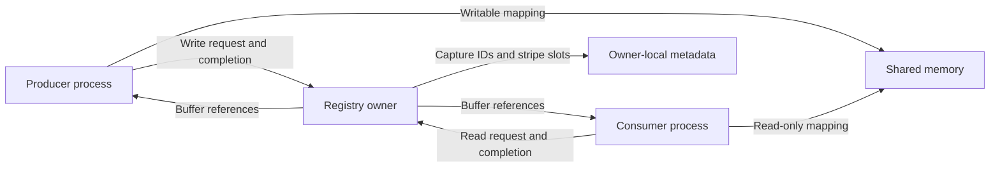

# Central registry: implementation guide

The implementation is in [`src/core/central_registry.py`](../src/core/central_registry.py).
It joins primitive inputs by capture ID, keeps their payloads in shared memory,
and lets each consumer lease its latest complete primitive or group. The registry
process owns the dictionaries, events, slot pools and reader counts. Stage
processes receive references to the shared buffers through pipes.

The performance-sensitive implementation uses integer masks and cached binary
messages. These represent ordinary presence checks and buffer locations; the
examples below explain how those representations work.

## Assumptions

- Each primitive has one producer and one outstanding write lease.
- Producers write each primitive once per nonnegative capture ID.
- Matching inputs use the same capture ID, even when their arrival times differ.
- Each consumer holds one read lease at a time across its subscriptions.
- Consumers want the latest complete matching capture; intermediate captures may
  be skipped. The registry does not queue every capture for every consumer.
- Every derived view or array is used inside its lease.
- Registration can happen during acquisition. Existing memory blocks remain in
  place when capacity grows.

These assumptions let the registry avoid duplicate-write and overlapping-lease
checks. They are also needed for its memory budget to be sufficient.

## Capture IDs and physical slots are different

Each primitive has its own `SharedMemoryHelper`, shared-memory blocks and free
slot queue. A producer reserves a cell before knowing which capture it will
contain. The registry reads the completed cell's `ID` after the producer releases
its lease, then records the association:

```python
entries[capture_id][primitive] = slot
```

For example, this is a valid registry state:

| Capture ID | Image stripe | Sensor stripe |
| --- | --- | --- |
| 100 | Slot 3 | Slot 1 |
| 101 | Slot 4 | Missing |

Image slot 3 and sensor slot 1 belong to capture 100. Equal physical slot numbers
are unnecessary: `entries` performs the join. Consumers receive both views
through a subscription to the corresponding group.

`slots[slot]` holds `(SharedMemory, byte_offset)`. `slot_view()` slices the block's
existing buffer at that offset for exactly `ctypes.sizeof(primitive)` bytes.
Creating this `memoryview` does not copy those bytes.

## How the bit masks represent presence

### One bit per primitive

`_bits` assigns a different power of two to each primitive:

```python
self._bits.setdefault(primitive, 1 << len(self._bits))
```

`1 << n` moves the binary digit `1` left by `n` positions:

| `n` | `1 << n` in binary | Decimal |
| --- | --- | --- |
| 0 | `001` | 1 |
| 1 | `010` | 2 |
| 2 | `100` | 4 |

When a primitive is new, the dictionary length gives the next unused position.
`setdefault` preserves an existing primitive's assignment. Registration of
additional primitives therefore leaves every existing entry and group mask valid.

The following examples assume Image=`001`, Sensors=`010`, Other=`100`.
The actual assignments depend on which primitive the owner encounters first,
including primitives mentioned in subscriptions before their producers register.
No particular datatype is guaranteed a particular bit position.

### OR adds a primitive or combines a group

Bitwise OR, `|`, sets a result bit if either operand has that bit set:

```text
    001   Image
  | 010   Sensors
  -----
    011   Image and Sensors
```

`entry.mask |= helper.bit` marks a newly published primitive as present while
keeping all previously set bits. `_track_group()` uses the same operation to
combine all primitives required by a subscription into `_masks[required]`.

OR is used instead of addition. `001 | 001` is still `001`, whereas adding those
values gives `010`, which would incorrectly indicate a different primitive.
The presence bit is stable; duplicate payload writes remain outside the producer
contract.

### AND tests whether every required primitive is present

Bitwise AND, `&`, sets a result bit only if both operands have it set. The registry
checks:

```python
(entry.mask & required_mask) == required_mask
```

AND removes bits the group does not require. Equality then means that every
required bit survived. Extra primitives are allowed:

| Entry mask | Required mask | AND result | Complete? |
| --- | --- | --- | --- |
| `001` — Image | `011` — Image + Sensors | `001` | No |
| `101` — Image + Other | `011` — Image + Sensors | `001` | No |
| `011` — Image + Sensors | `011` — Image + Sensors | `011` | Yes |
| `111` — All three | `011` — Image + Sensors | `011` | Yes |
| `010` — Sensors | `010` — Sensors | `010` | Yes |

This runnable example follows the same operations as publication:

```python
IMAGE, SENSORS, OTHER = 0b001, 0b010, 0b100
required = IMAGE | SENSORS
present = IMAGE
assert (present & required) != required
present |= SENSORS
assert (present & required) == required
present |= OTHER
assert (present & required) == required
```

The source writes `entry.mask & mask == mask`; Python groups that expression as
`(entry.mask & mask) == mask`.

The mask mirrors the keys in `entry`. It says which pieces are present; the
dictionary still says where their payloads are stored. It contains neither the
capture ID nor reader counts. Python integers can grow beyond 32 or 64 bits, so
the representation imposes no fixed datatype-count limit. Integer operations
still scale with the number of integer digits for very large masks.

## Metadata and why it is cached

| Field | Meaning | Work avoided |
| --- | --- | --- |
| `data_array[primitive]` | Storage helper for that stripe | Rebuilding buffer layouts |
| `entries[id]` | Primitive slots for a retained capture | Searching stripes for an ID |
| `entry.mask` | Published primitive bits | Building sets of present fields per publication |
| `entry.readers` | Active read leases on the full capture | Per-primitive reader bookkeeping |
| `latest[group]` | Highest complete capture ID seen for this group | Scanning retained captures on every read |
| `events[group][consumer]` | Whether unread matching data is available | Busy-waiting for new inputs |
| `last_read[consumer, group]` | This subscription's consumed or currently leased ID | Re-delivering the same match |
| `_bits[primitive]` | Stable presence bit | Reassigning primitive positions |
| `_masks[group]` | Combined required bits | Recombining a group's requirements |
| `_affected[primitive]` | Groups requiring this primitive | Testing unrelated groups on publication |
| `_singletons[primitive]` | Cached one-primitive `frozenset` | Allocating a subscription key on every primitive read |
| `entry.latest_groups` | Groups whose latest ID points here | Scanning every group on eviction |

`_consumers` counts distinct stage identities for sizing. A stage with several
subscriptions counts once under the one-active-read assumption.

`Entry` is a dictionary with `readers`, `mask` and `latest_groups` stored in
`__slots__`. This keeps those fixed fields outside a separate instance attribute
dictionary.

`_track_group()` runs once for each distinct group. It assigns any missing bits,
builds the required mask and publication index, and scans existing entries for a
match. That initial scan is needed when registering a consumer during acquisition.
Subsequent publications update the cached result incrementally.

When a group advances from capture 100 to 101, it is removed from
`entries[100].latest_groups` and added to `entries[101].latest_groups`. This is
the inverse of `latest[group] = 101`. If entry 100 has already been evicted, there
is no old reverse index to update.

Producer registration tracks the singleton group and the set of all currently
registered producers. Subscriptions are immutable sets: adding a producer does
not change an existing consumer's group. A consumer that needs the expanded set
must register that set explicitly. Earlier tracked groups remain valid.

## Writer lease: reserve, fill, associate

1. Under `_lock`, reserve a free cell from this primitive's queue.
2. Yield its writable view. The producer fills it directly, including `ID`.
   The metadata lock is released while the producer works.
3. On successful exit, read the ID and call `_record_data()` while the view is
   still valid. The helper caches the ID field's offset and a `Struct` decoder,
   so the registry reads only that small field rather than constructing an image
   struct or copying its payload.
4. Under `_lock`, find or create the capture entry. If capacity is full and a
   new entry is needed, evict the oldest entry without readers.
5. Store the primitive's slot and OR its bit into `entry.mask`.
6. Test only `_affected[primitive]`. A complete group advances only if this ID
   exceeds its previous latest ID; update its reverse index and subscriber events.
7. Release the temporary view. If the write failed or was discarded, return the
   reserved cell to the free queue. Published cells stay allocated to their entry.

A failed write does not publish its bytes or evict an entry simply to obtain a
cell. The extra cell in each stripe makes allocation possible before association.

`_record_data()` currently logs input metadata. It does not save image or sensor
payloads to disk. A future persistence implementation belongs in this hook and
must finish accessing the leased view before returning. It runs outside `_lock`
and before association or stale-ID rejection, so rejected inputs also reach it.

## Latest ordering and stale-ID admission

There are two separate high-water marks:

- `latest_id` is the highest received ID from any producer, including incomplete
  captures.
- `latest[group]` is the highest complete ID for that particular group.

A group starts with `latest[group] = None`. The global mark and each consumer's
cursor start at `-1`, below every valid capture ID.

An older capture already present in `entries` can receive a missing primitive.
An absent ID below `latest_id` is discarded. For example, if Image 100 is retained
and Image 108 arrives, Sensors 100 can still complete capture 100. Sensors 97 is
discarded if capture 97 is absent, even when no complete group has reached 108.

Neither mark moves backwards. When a latest complete entry is evicted,
`latest[group]` keeps its ID and its subscribers' events are cleared. An older
retained match cannot become the group's latest again; consumers wait for a
newer complete match. This also prevents late fields from resurrecting evicted
captures as fresh packets.

`entries` is an `OrderedDict` in entry-creation order. Adding another primitive
to an existing capture does not move it. Eviction scans from the oldest entry,
skips captures with active readers, and frees every primitive cell belonging to
the first eligible capture.

## Reader lease: wait, pin, release

Each subscription has its own event, so one consumer clearing its readiness does
not consume another consumer's notification. An event is a readiness flag,
not a queue or packet counter. Several publications before the next read coalesce
into one notification, and that read receives the highest complete matching ID.

1. Wait on the subscription's event. A stage process blocks on its pipe while
   the registry's worker waits on this owner-local event.
2. Take `_lock` and check the event again. Eviction may have cleared it between
   waking and acquiring the lock.
3. Obtain the latest complete entry, create read-only views for the required
   primitives, and increment `entry.readers`.
4. Save the previous cursor, set `last_read` to the leased ID, and clear the event.
   The cursor also lets the pipe server identify this active lease.
5. Yield the views with the metadata lock released. The reader count keeps all
   cells belonging to this capture out of the eviction path.
6. Release the views and decrement the reader count under `_lock`. On failure,
   restore the old cursor and recompute readiness, allowing a retry of the latest
   retained match.

If a newer match arrives during a lease, publication sets the event again.
Successful release does not clear that notification. The next read obtains the
newer capture. If the newest match was evicted during a failed read, readiness
stays clear until a newer complete retained match becomes available.

The reader count belongs to the full capture. A primitive reader therefore pins
every cell already associated with that entry. A missing primitive may still be
added in a different cell; the no-duplicate-write assumption prevents an existing
primitive from being overwritten while a reader uses it.

Read-only views enforce access through that view; the reader count and slot pool
enforce safe reuse. All arrays or additional views derived from a leased buffer
must also stay inside the lease, because the cell may be reused after release.

## Capacity, the spare cell, and live growth

For `k` distinct consumers and matching window `w`, the registry uses:

```python
array_length = max(ARRAY_LENGTH, k + w)
buffer_length = max(BUFFER_LENGTH, array_length + 1)
```

With the default `w = 16`, this is `k + 16` retained entries and `k + 17` cells
per primitive. For `p` stripes there are `p * (k + 17)` cells, with byte sizes
determined by each datatype rather than a common image-sized cell.

At most `k` entries are pinned under the read-lease assumption. The matching
window reserves additional space for recent captures, including incomplete ones.
The extra cell per stripe is for its one outstanding writer: its ID is not known
yet, so the registry cannot decide which entry to associate or evict at allocation.

Once the write completes, association either uses an existing entry or evicts an
unread entry before creating a new one. Discard and failure return the spare cell
directly. This maintains available write storage without having the helper decide
which capture to discard.

The window is measured in captures, not time. A 16-capture budget is intended to
cover a lead of 15 captures, about 250 ms at 60 Hz, with reader-held captures
budgeted separately. Delays beyond retention can lose a match and produce stale-ID
warnings; the registry cannot retain arbitrary desynchronization in bounded space.

When a new consumer increases capacity, `grow()` appends a new shared-memory block
and new slot descriptors. It does not resize, rename or move existing blocks.
Existing reader and writer views therefore remain valid. A newly registered
primitive gets its own stripe at the current capacity.

## Process transport and the packed references

`PipelineStage.start()` obtains a `RegistryClient` from `for_stage()`. The owner
creates a pipe and worker thread for each registered subscription or producer
port. Separate ports allow a stage to hold an input lease while writing an output.



Each port retains a fixed primitive ordering. The owner constructs this tuple
and passes it with the client; reconstructing order from a `frozenset` in a spawned
process could pair an image reference with the sensor datatype.

The connection exchanges these message bodies:

| Direction | Message | Meaning |
| --- | --- | --- |
| Stage to owner | `b"W"` or `b"R"` | Request the next write or read lease on this port |
| Owner to stage | `b"B" + names` | New shared-memory names, separated by NUL bytes |
| Owner to stage | `b"F" + references` | Packed block-index/byte-offset pairs for this lease |
| Stage to owner | `b"1"` | Lease completed successfully |
| Stage to owner | `b"2"` | Lease failed; trigger the context manager's rollback |
| Stage to owner | `b"0"` | Stop this reader connection after releasing the current lease |

The port is already registered as reading or writing; the owner does not need to
deserialize a datatype or dispatch on the request letter.

For each connection, `known_blocks` maps a memory name to a small sequential
index. The client's `blocks` list uses the same order. New names are sent once
in a B message, and the client attaches to them before decoding the next F message.
Live growth can add B messages later without invalidating earlier indexes.

The precompiled layout is:

```python
Struct("<" + "IQ" * primitive_count)
```

`<` selects little-endian byte order and standard sizes without alignment padding.
Each `I` is a 4-byte unsigned block index; each `Q` is an 8-byte unsigned offset in
bytes. References are flattened as `[block0, offset0, block1, offset1, ...]`.
The F body is `1 + 12 * primitive_count` bytes: 13 bytes for one primitive or
25 for an image/sensor pair, regardless of image resolution. The multiprocessing
pipe adds its own framing bytes.

For example, names at client indexes 0 and 1, with references `[0, 96, 1, 0]`, mean
“use the first block at byte 96 and the second block at byte 0.” The datatype's
size determines the end of each view. A slot index is never mistaken for a byte
offset, and absolute virtual addresses are never sent between processes.

For a write, `reserve_slot()` records `helper.writing_slot`. The one-outstanding-
writer assumption makes that slot sufficient for the server to call
`slot_location()` directly. This retains the earlier optimization that avoids
scanning blocks and computing offsets from buffer addresses. For reads, the entry
already provides each primitive's slot, so the same method supplies its location.

The owner holds its context manager open until the acknowledgement arrives.
A write becomes visible to readers only after the owner processes its successful
acknowledgement and associates the cell. A read acknowledgement ends the reader
pin. `_CancelledLease` routes a failure acknowledgement through the same exception
cleanup as a failed local lease, then allows the connection to serve another request.

Only metadata is packed or copied by this protocol. Stage views slice attached
shared memory directly. End-to-end zero-copy also requires producers to acquire
or generate into the writable lease, and consumers to use those views directly.

## Shutdown and verification

`_ConsumerEvent` is an ordinary event with a stop check during timed 100 ms waits.
The thread sleeps while waiting; it does not spin over registry contents. A stage
waiting for its first packet can therefore stop without needing another publication.
Stop and join stage processes before closing the registry so active leases finish
and their client attachments close. `CentralRegistry.close()` signals stop flags,
joins connection workers, closes pipes, and closes/unlinks the owner's blocks.

The implementation retains the measured performance optimizations. Future
simplifications should be benchmarked against it before being kept. Source
comments and this guide explain the caches without adding work to the frame path.

The [restoration benchmark](central_registry_restore_benchmark.json) compares
the saved versions using actual pipe leases, owner threads and in-process clients.
Each variant has five interleaved runs of 3,000 captures after 300 warmup captures.
Logging is disabled and the primitive structs are small; these numbers measure
lease and metadata CPU costs, excluding image filling and camera acquisition.

| Stripes / consumers | Restored masks + packed | Original masks + packed | Sets + packed | Sets + plain references |
| --- | --- | --- | --- | --- |
| 2 / 1 | 73.46 µs | 75.08 µs | 72.70 µs | 77.15 µs |
| 2 / 8 | 265.83 µs | 265.80 µs | 261.35 µs | 278.38 µs |
| 8 / 1 | 229.40 µs | 239.52 µs | 233.95 µs | 251.58 µs |

Values are median CPU time per capture across all producer and consumer leases.
The restored version uses about 4.5–8.8% less CPU than the latest plain-reference
simplification in these cases. The intermediate set-based version is slightly
ahead in the two-stripe cases and behind in the eight-stripe case; these figures
do not establish one winner for every subscription pattern. The earlier
group-matching benchmark also found a cost to removing masks with eight stripes.
The retained direct writer-slot lookup improves on the original pointer scan,
with the eight-consumer result effectively unchanged within measurement noise.

The benchmark also checks that the executable source matches the saved mask-based
implementation with just the retained direct writer-slot lookup. Documentation
does not add work to acquisition or consumption.

Focused checks cover matching and out-of-order fields, reader protection,
failed-lease retries, live growth, stale-ID rejection, and real stage transport:

```sh
PYTHONPATH=src .venv/bin/pytest -q \
  tests/test_central_registry.py \
  tests/test_central_registry_demo.py \
  tests/test_pipeline_stage_registry.py \
  tests/test_pipeline_runtime.py
```

The runtime tests also exercise independent image and sensor processes at 60 Hz
with consumers holding leases for several seconds. They check matched IDs and
clean shutdown; they are not substitutes for testing acquisition performance on
the target camera and hardware.
